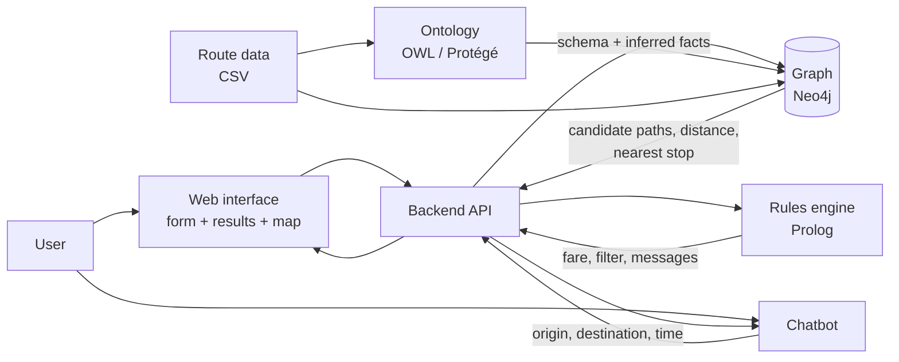

# GasRek! — Surabaya Bus Guide

> **Gas, Rek!** Tell us where you are and where you want to go. GasRek! tells you which bus to take, where to transfer, when it leaves, when you arrive, and how much it costs.

An open-source platform for finding public transportation routes, especially buses, in Surabaya. Users get the best route, schedule, fare, and other trip details. The system is built on knowledge representation: **ontology, graph, and rules**.

This project was created to fulfill the Final Project of the **Knowledge-Based Systems Engineering** course (*Rekayasa Sistem Berbasis Pengetahuan*), Department of Informatics, Institut Teknologi Sepuluh Nopember (ITS), 2026.

> **Status:** planning and initial setup. Data, models and application code are being built (see [Timeline](#timeline)).

---

## Table of contents

1. [Background](#background)
2. [What GasRek! does](#what-gasrek-does)
3. [Example](#example)
4. [Scope](#scope)
5. [How it works: three knowledge representations](#how-it-works-three-knowledge-representations)
6. [Architecture](#architecture)
7. [Tech stack](#tech-stack)
8. [Repository structure](#repository-structure)
9. [Team](#team)
10. [Task division](#task-division)
11. [Timeline](#timeline)
12. [Test scenarios](#test-scenarios)
13. [Getting started](#getting-started)
14. [Contributing](#contributing)
15. [License](#license)

---

## Background

Surabaya has several city bus services: **Suroboyo Bus**, **Wira Wiri Suroboyo** (feeder) and **Trans Semanggi Suroboyo**. Together they cover much of the city, but for a passenger, especially a newcomer, it is hard to answer simple questions:

- Which bus goes from here to my destination?
- Do I need to change buses, and where?
- Is there still a bus at this hour, or has the last one left?
- How long will it take, and how much will it cost?

The information exists, but it is scattered across apps, articles and route maps, and stop names differ between sources. GasRek! puts this knowledge in one place and answers these questions directly, from the passenger's point of view.

## What GasRek! does

The passenger enters an **origin stop**, a **destination stop** and a **departure time**, by filling in a form or by typing a sentence in the chatbot. GasRek! returns:

| Output | Description |
| --- | --- |
| Departure and arrival time | When the bus leaves the origin stop and when it reaches the destination |
| Travel duration | Total time, including waiting time at transfer stops |
| Remaining routes for today | All routes still available for the rest of the day; departures that have already passed are hidden |
| Transfers | Which bus to take, where to get off, and which bus to change to |
| Total fare | Based on the operator's fare rules and passenger type (general or student) |
| Stops passed | The ordered list of stops along the trip |
| Total distance | Distance of the whole trip in kilometers |
| Route map | The route drawn on a map |

Additional behaviour:

- **Fastest or cheapest filter.** When selected, only **one** route is shown: the one with the shortest duration or the lowest fare.
- **No more buses today.** If routes exist but all have finished for the day, the system shows *"Sisa rute hari ini sudah habis, tunggu besok"* (remaining routes for today have ended, please wait until tomorrow).
- **No route.** If no route connects the two stops, the system shows *"Tidak ada rute untuk tujuan tersebut"* (no route available for that destination).
- **Nearest alternative stop.** In both cases above, the system suggests the nearest alternative stop that does have a route, or says *"tidak ada"* (none) if there is none.
- **Chatbot.** Users can ask in everyday language, for example *"Aku di Halte ITS, mau ke Tunjungan jam 3 sore"* (I'm at ITS stop, going to Tunjungan at 3 pm). The chatbot only reads the question and explains the answer; the route, schedule and fare always come from the knowledge base, never invented by the chatbot.

## Example

> **Rina** has just moved to Surabaya to study at ITS. This afternoon she wants to go to Tunjungan. She does not know which bus to take, where to change, or whether buses still run in the evening. She only knows the stop where she stands and her destination.

She types: *"Dari Halte ITS ke Tunjungan, berangkat jam 15.00, saya pelajar."*

GasRek! answers with every route still available today, for example: take bus A from ITS, get off and transfer at stop X, continue with bus B to Tunjungan. For each route it shows the departure and arrival times, duration, stops passed, distance and total student fare. If she asks for the fastest route, she gets one route only. If she asks at 21.30, she is told that today's routes have ended and is shown the nearest alternative stop.

## Scope

**In scope**

- **Area:** the whole city of Surabaya.
- **Operators (3):** Suroboyo Bus, Wira Wiri Suroboyo, Trans Semanggi Suroboyo.
- **Knowledge:** operators, routes, stops in both directions, stop order, operating hours, headway, fares and fare rules, transfer stops, stop coordinates.
- **Interface:** web application with a search form, results view and chatbot.

**Out of scope**

- Real-time bus position and traffic conditions.
- Ticket purchase and payment.
- Other operators and modes (DAMRI, trains, angkot, ride-hailing).
- Exact per-stop timetables from the operator. Times are **estimated** from operating hours, headway and travel time between stops.

**Data sources:** Moovit as the standard source for routes, stops, hours and headway; news articles for routes not available on Moovit; OpenStreetMap for stop coordinates; cross-checked against the official GOBIS app. Details are documented in [`data/README.md`](data/README.md) once the data is final.

## How it works: three knowledge representations

GasRek! uses three knowledge representations as three layers. Each one has its own job, and each one produces a result that is visible in the application.

| Representation | Tool | Role in GasRek! | Visible result |
| --- | --- | --- | --- |
| **Ontology** | OWL, built in Protégé | Defines the vocabulary: what an Operator, Route, Stop, Fare and Transfer Stop are, and how they relate. Acts as the schema of the data and infers new facts. | Transfer stops and stop groups are **inferred**, not typed by hand. Stops with different names at the same location are recognised as one place. |
| **Graph** | Neo4j | Stores stops and the order in which routes visit them. Finds paths from origin to destination, including transfers, and finds the nearest stop by coordinates. | Candidate routes, stops passed, total distance, nearest alternative stop. |
| **Rules** | SWI-Prolog (or a Python rule module) | Makes decisions that depend on time and conditions: fare calculation, hiding departed buses, end-of-service and no-route messages, choosing alternatives, fastest or cheapest filter. | Total fare, remaining routes only, "routes have ended" or "no route" messages, the single fastest or cheapest route. |

**Why this split?** Each task goes to the representation that is strongest at it. The ontology captures *meaning and categories*, the graph is fast at *paths and distances*, and rules express *decisions that change with time and conditions*. Any of them could do some of the others' work, but this split keeps every representation doing real work and makes the reasoning easy to explain.

**Flow of one search**

1. The user asks through the form or the chatbot.
2. The chatbot (if used) turns the sentence into origin, destination, time, passenger type and preference.
3. The **graph** finds candidate routes, using the stop groups and transfer stops defined by the **ontology**.
4. The **rules** compute times and fares, remove departed buses, apply the filter, and decide which message and alternative to show.
5. The interface shows the result; the chatbot explains it in plain language.

## Architecture



See [`docs/architecture.md`](docs/architecture.md) for details and [`docs/api-contract.md`](docs/api-contract.md) for the interface between components.

## Tech stack

| Part | Technology |
| --- | --- |
| Ontology | OWL 2, Protégé 5.6, HermiT reasoner, Owlready2 (Python) for populating and exporting inferred facts |
| Graph database | Neo4j Desktop 5, Cypher, Graph Data Science library; data loaded from CSV |
| Rules | SWI-Prolog 9 + PySwip |
| Backend | Python 3.11, FastAPI |
| Frontend | React (Vite), Leaflet with OpenStreetMap tiles |
| Chatbot | Google Gemini API (free tier) with function calling, plus a pattern-based fallback |
| Data preparation | Python, CSV |

The stack is final. Decisions and their reasons are recorded in [`docs/architecture.md`](docs/architecture.md).

## Repository structure

```
GasRek-Surabaya-Bus-Guide/
├── README.md               Project overview (this file)
├── CONTRIBUTING.md         Team workflow: branches, commits, pull requests
├── LICENSE
├── .gitignore
├── .gitattributes
├── .env.example            Template for local settings (copy to .env)
├── .github/
│   └── pull_request_template.md
├── docs/
│   ├── architecture.md     Components and how they connect
│   ├── api-contract.md     Requests and responses between components
│   ├── test-scenarios.md   Test cases Q1–Q7 and their expected results
│   └── tasks/              Task sheet and checklist for each member
│       ├── naura.md
│       ├── nashwa.md
│       └── fathiya.md
├── data/                   Route, stop and fare data
│   ├── raw/                Data as collected, per source
│   └── processed/          Clean data used by the system
├── ontology/               OWL ontology (Protégé)
├── graph/                  Neo4j import scripts and Cypher queries
│   ├── import/
│   └── queries/
├── rules/                  Prolog rules for time, fare and alternatives
├── backend/                API that connects ontology, graph and rules
├── chatbot/                Chatbot: understanding questions, explaining answers
├── frontend/               Web interface
└── tests/                  Automated and manual tests
```

## Team

| Name | Student ID (NRP) | Main responsibility |
| --- | --- | --- |
| Naura Taqiyya Mazi | 5025241119 | Project lead, graph (Neo4j), backend API, chatbot |
| Nashwa Aulia Putri Diansyah | 5025241064 | Data, ontology (Protégé), test scenarios, documentation |
| Fathiya Nayla Husna Wibowo | 5025241204 | Rules engine, web interface |

## Task division

The dataset for the whole of Surabaya was completed on 21 November, so every member starts directly on their components.

| Area | Naura | Nashwa | Fathiya |
| --- | --- | --- | --- |
| Data collection | Done (21 Nov) | Done (21 Nov) | Done (21 Nov) |
| Knowledge representation | Graph model, import, routing queries | Ontology: classes, properties, inference | Rules: time, fare, filter, alternatives |
| Application | Backend API, chatbot | — | Web interface (form, results, map, chat panel) |
| Testing and documentation | Integration, demo | Test scenarios, final documentation | UI testing |

Detailed tasks, specifications and checklists:

- [Naura — graph, backend, chatbot](docs/tasks/naura.md)
- [Nashwa — data, ontology, testing, documentation](docs/tasks/nashwa.md)
- [Fathiya — rules, web interface](docs/tasks/fathiya.md)

## Timeline

Duration: **2 weeks**, from **Friday 20 November 2026** to **Friday 4 December 2026**.

| Phase | Dates | Goal | Done when |
| --- | --- | --- | --- |
| 1. Setup | Fri 20 – Sun 22 Nov | Repository ready, tools installed, everyone has read their task sheet, the data format and the API contract | Everyone can open the repo and run the tools |
| 2. Data | Sat 21 Nov | Routes and stops of 3 operators for the whole of Surabaya collected and cleaned | **Done.** `data/processed/` complete (see [`data/README.md`](data/README.md)) |
| 3. Build | Mon 23 – Sat 28 Nov | Ontology, graph, rules, backend, interface and chatbot built in parallel | Each component works on its own with sample data |
| 4. Integration | Sat 28 Nov – Tue 1 Dec | Components connected end to end | A search from the interface returns a real answer |
| 5. Testing and fixes | Tue 1 – Thu 3 Dec | Q1–Q7 tested, bugs fixed, documentation written | All test scenarios pass or have a known reason |
| 6. Final | Fri 4 Dec | Final check, demo rehearsal | Demo runs from start to finish without help |

**Checkpoints:** short team check-in every 2 days (Sun 22, Tue 24, Thu 26, Sat 28 Nov, Mon 30 Nov, Wed 2 Dec), and a full demo run on Thu 3 Dec.

## Test scenarios

| ID | Scenario | Expected result |
| --- | --- | --- |
| Q1 | Trip that needs one transfer | Route with one transfer, correct transfer stop |
| Q2 | Transfer stop between two routes | The shared stop is found (inferred by the ontology) |
| Q3 | Search at a normal hour | All remaining routes today with times, duration and fare |
| Q4 | Fastest filter | One route with the shortest duration |
| Q5 | Cheapest filter | One route with the lowest fare |
| Q6 | Search after the last bus | "Routes for today have ended" + nearest alternative stop |
| Q7 | Destination with no route | "No route" + nearest alternative stop, or "none" |

Full cases, inputs and expected outputs, plus extra cases for the chatbot and fares (Q8–Q10): [`docs/test-scenarios.md`](docs/test-scenarios.md).

## Getting started

Setup instructions will be added once the first components are ready. Planned requirements:

- Python 3.11 or newer
- Node.js 20 or newer
- Neo4j Desktop (or Docker)
- Protégé 5.6
- SWI-Prolog 9

Copy `.env.example` to `.env` and fill in your own values. Never commit `.env`.

## Contributing

This is a team project. The workflow (branches, commit messages, pull requests, using GitHub Desktop) is in [`CONTRIBUTING.md`](CONTRIBUTING.md).

## License

Released under the [MIT License](LICENSE).

## Acknowledgements

Final Project for the Knowledge-Based Systems Engineering course (*Rekayasa Sistem Berbasis Pengetahuan*), Department of Informatics, Institut Teknologi Sepuluh Nopember, 2026. Route information belongs to the respective operators; map data © OpenStreetMap contributors.
