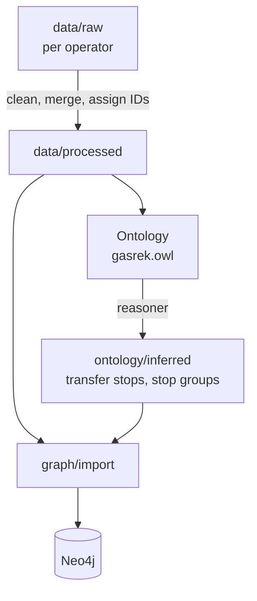
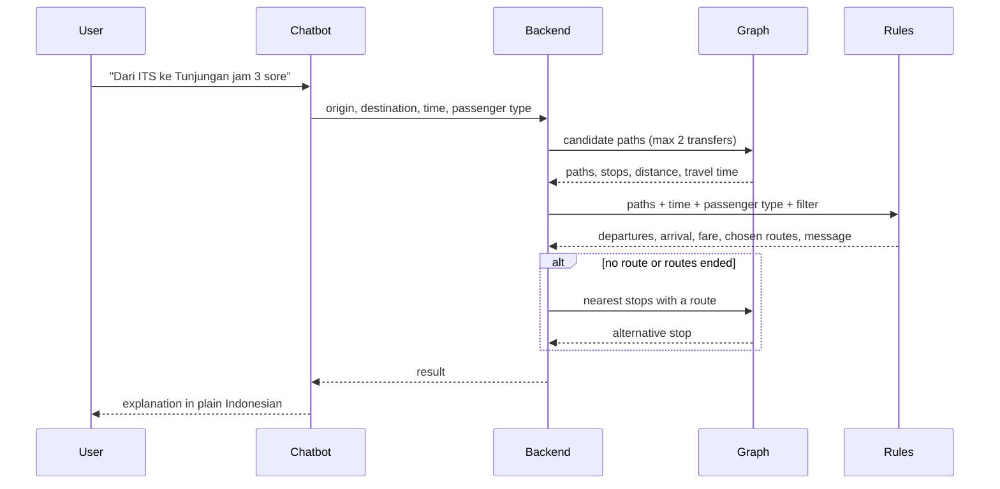

# Architecture

GasRek! has three knowledge layers (ontology, graph, rules) behind one backend API, which serves the web interface and the chatbot.

## Components

| Component | Folder | Owner | Responsibility |
| --- | --- | --- | --- |
| Data | `data/` | Nashwa | Routes, stops, coordinates, fares of 3 operators in clean CSV |
| Ontology | `ontology/` | Nashwa | Vocabulary and schema; infers transfer stops and stop groups |
| Graph | `graph/` | Naura | Stores the network; finds paths, distances and nearest stops |
| Rules | `rules/` | Fathiya | Time, fare, filter, messages and alternatives |
| Backend | `backend/` | Naura | API that runs a search through graph and rules |
| Chatbot | `chatbot/` | Naura | Turns a sentence into search parameters and explains results |
| Frontend | `frontend/` | Fathiya | Search form, results, route detail, map, chat panel |

## Data flow

## Search flow

## Design decisions

| Decision | Reason |
| --- | --- |
| Transfer stops come from the ontology, not from a graph query | Keeps the ontology doing real work and gives one source of truth for "what counts as a transfer" |
| Times are estimated from first departure, headway and travel time | Operators do not publish complete per-stop timetables |
| Maximum 2 transfers per trip | Keeps search fast and results realistic for passengers |
| Chatbot never produces routes, times or fares itself | Answers must come from the knowledge base and be verifiable |
| Rules in SWI-Prolog, called through PySwip | Prolog shows the rule-based representation clearly. If PySwip still does not run on Windows by Monday 23 Nov, the same rules are written in Python (`rules/engine_fallback.py`) and the `.pl` file stays as the documented rule base |
| Neo4j data loaded from CSV, not through neosemantics | Simpler setup on Windows; the ontology's inferred facts are exported to CSV and loaded the same way |
| Chatbot uses the Gemini API free tier | Free for students, supports function calling; a pattern-based fallback keeps the demo working without internet or quota |
| Frontend in React + Leaflet | Common, well documented, and Leaflet draws routes on OpenStreetMap without an API key |
| One public repository on Naura's account (`Takia777`), MIT license | Open-source project; one place for code, data and documentation |

## Change log

| Date | Change | By |
| --- | --- | --- |
| 2026-11-20 | Initial architecture | Team |
